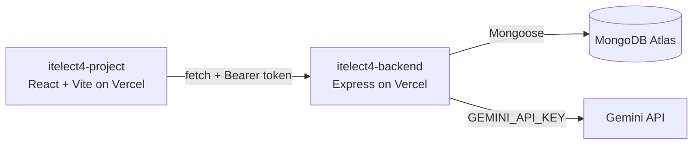

# ITELECT4 Frontend

[](https://github.com/chesterboriz/itelect4-project/actions/workflows/ci.yml)

React + TypeScript + Vite frontend for the Campus Lost & Found system.

## 🔗 Live Links

| | URL |
|---|---|
| **Live Frontend** | https://itelect4-project-nu.vercel.app |
| **Live Backend** | https://itelect4-backend-chi.vercel.app |

## 🏗 Architecture



## 🛠 Tech Stack

- **Framework**: React 18 + TypeScript
- **Build Tool**: Vite
- **Routing**: React Router v6
- **State Management**: Zustand
- **Form Validation**: Zod + React Hook Form
- **Deployment**: Vercel

## 📄 Pages

| Route | Description | Auth Required |
|-------|-------------|--------------|
| `/` | Dashboard | No |
| `/courses` | Course list | No |
| `/courses/:code` | Course detail | No |
| `/items` | Lost & Found items | No |
| `/items/:id` | Item detail | No |
| `/register` | Register account | No |
| `/login` | Login | No |
| `/submissions` | My submissions | ✅ Yes |
| `/review` | AI Project Review | ✅ Yes |
| `/account` | Account info | ✅ Yes |

## 🚀 Run Locally

```bash
# Install dependencies
npm install

# Copy env file and fill in values
cp .env.example .env

# Start dev server
npm run dev
```

## ⚙️ Environment Variables

```env
VITE_API_URL=http://localhost:4000
```

## 🤖 AI-Use Disclosure

This project utilized AI assistance (Google Gemini / Antigravity) for automated test suite scaffolding, TypeScript type refinement, and CI workflow configuration in accordance with course guidelines.
